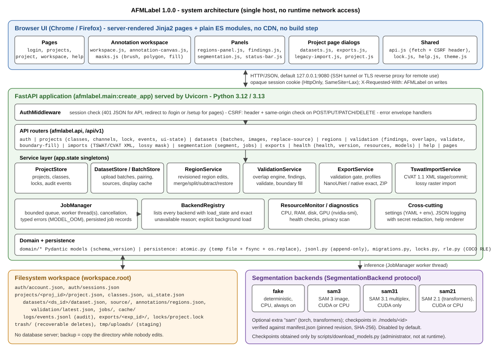
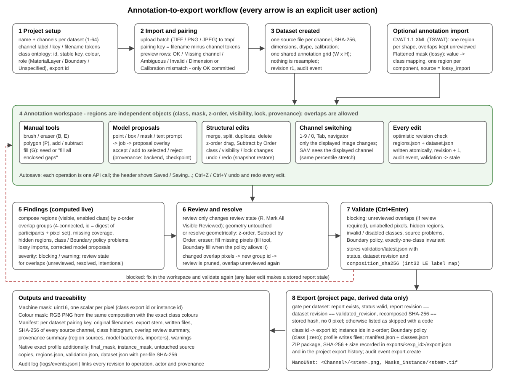
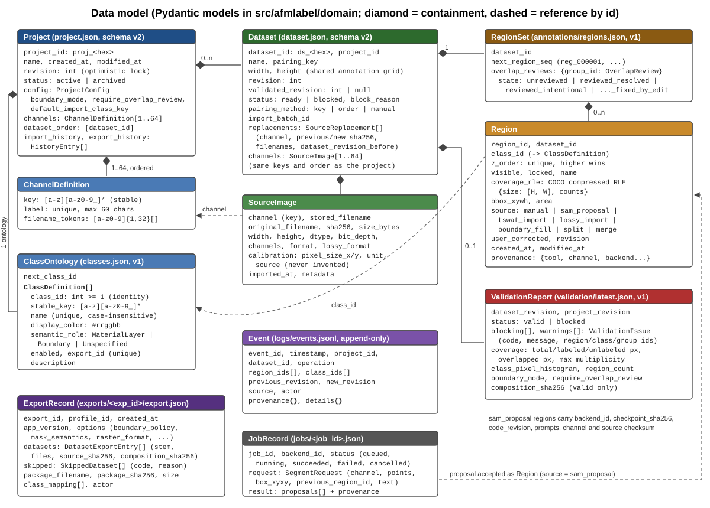
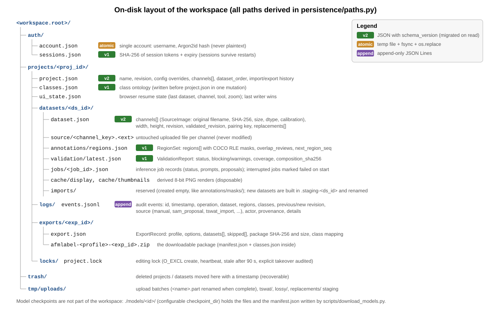
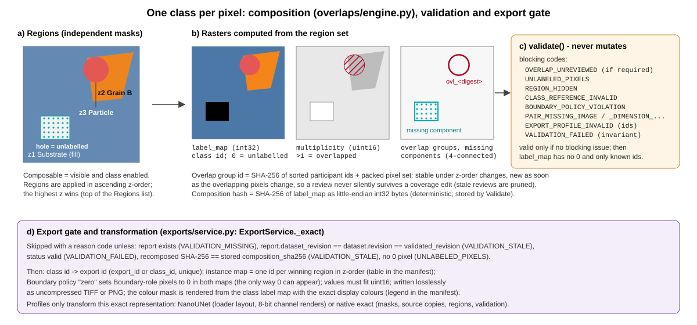

# AFMLabel - technical documentation

**Document purpose:** describes how AFMLabel is designed - architecture, components, data structures, interfaces, algorithms, security - and the principles and decisions behind the design.
**Software version:** AFMLabel 1.0.0

Module paths are relative to `src/afmlabel/` unless stated otherwise. Everything in this document was derived from the source code of version 1.0.0.

## 1. Design principles

The design follows a small set of principles that recur in every component:

1. **Scientific traceability over convenience.** Every exported pixel must be explainable: which source files (by SHA-256), which regions, which tool or model, which review and which validation produced it. Nothing scientific is decided silently (no automatic class guessing, no silent resampling, no silent model fallback).
2. **Annotation state is canonical; masks are derived.** Users edit independent, possibly overlapping *regions*. The single-class-per-pixel mask is *computed* (composition) and exported only after an explicit validation of the current revision.
3. **Separation of geometry, review and validation.** Geometry operations change regions; review only changes the review state of overlap Findings; validation only stores a report. None of them performs another one implicitly.
4. **Local-only and offline.** The application, its assets and its models run on one host; there is no runtime network access, no CDN and no telemetry.
5. **Crash-safe plain files.** All state is JSON (plus the original images) in a workspace directory, written atomically, versioned with `schema_version` and migrated on read; the audit log is append-only.
6. **Optimistic concurrency.** Every mutation carries the expected revision; a mismatch is a typed conflict, never a silent overwrite. A per-project editing lock is a courtesy layer on top.
7. **Optional, isolated heavy dependencies.** PyTorch and model code are optional extras behind a backend protocol; the core (FastAPI, NumPy, Pillow, pycocotools) runs CPU-only on any platform.

## 2. Architecture overview



*Figure 1 - Components and their dependencies.*

AFMLabel is a single-process web application:

- **Browser UI.** Server-rendered Jinja2 pages (`templates/`) with plain ES modules (`static/js/`) and CSS; no build step, no external assets. The annotation canvas, mask operations (brush, fill, component labelling for the fill tool) and the undo stack run in the browser; every change is sent to the server as one API operation.
- **FastAPI backend.** `main.create_app()` builds the application, creates the service singletons on `app.state`, installs the authentication/CSRF middleware and the JSON error envelope, mounts the static files and includes the routers. Uvicorn serves it (`afmlabel serve`).
- **Service layer.** Stores and services own all business rules (`projects/`, `annotations/`, `validation/`, `exports/`, `imports/`, `jobs/`). Routers are thin: they validate request bodies (Pydantic), check the editing lock and call one service method.
- **Domain and persistence.** Pydantic models (`domain/`) define every persisted document; `persistence/` provides atomic writes, the JSON Lines log, migrations, locks, path derivation and the mask codecs.
- **Filesystem storage.** One workspace directory (`workspace.root`) holds the account, sessions, projects, trash and temporary uploads.
- **Model backends.** `segmentation/` defines a backend protocol, a deterministic `fake` backend and three optional SAM backends; `jobs/manager.py` runs inference in worker threads.



*Figure 2 - Workflow from project setup to export and the artefacts each step produces.*

## 3. Components and package structure

| Package / module | Responsibility |
| --- | --- |
| `main.py` | Application factory `create_app(settings)`, CLI `afmlabel` (`serve`, `version`, `auth set-password|status|revoke-sessions`). |
| `settings.py` | Static configuration models (`AppSettings` with sections `workspace`, `server`, `runtime`, `models`, `security`, `annotation`, `resources`, `logging`, `export`, `upload`, `developer`), YAML loading, environment overrides, secret-key rejection. |
| `errors.py` | `AppError` with stable machine-readable codes (e.g. `REVISION_CONFLICT`, `VALIDATION_STALE`, `MODEL_UNAVAILABLE`) and HTTP status; subclasses `NotFoundError`, `ConflictError`, `AuthError`, `ForbiddenError`, `RevisionConflictError`. |
| `api/` | Routers: `auth`, `projects`, `datasets`, `regions`, `validation`, `imports`, `segmentation`, `exports`, `health`, `help`, `pages`; `deps.py` (request-scoped dependencies, actor and editor identity), `errors.py` (error envelope). |
| `auth/` | `account.py` (single account file), `passwords.py` (Argon2id), `sessions.py` (server-side sessions, login rate limiter), `middleware.py` (authentication and CSRF). |
| `domain/` | Pydantic models: `project.py` (Project, ChannelDefinition, ClassOntology, ClassDefinition, ProjectConfig, UiState, LockInfo), `dataset.py` (Dataset, SourceImage, Calibration, SourceReplacement), `region.py` (Region, RegionSet, OverlapReview, RleMask), `validation.py` (OverlapGroup, CoverageSummary, ValidationReport), `events.py` (Event), `jobs.py` (JobRecord, SegmentRequest), `common.py` (ids, timestamps, schema versions). |
| `persistence/` | `atomic.py` (atomic writes, retries), `jsonl.py` (append-only log), `migrations.py` (schema migrations), `locks.py` (project editing lock), `paths.py` (all workspace paths), `rle.py` (COCO RLE, row RLE, polygon rasterisation, connected components). |
| `projects/` | `store.py` (ProjectStore: projects, classes, UI state, events, locks, trash), `datasets.py` (DatasetStore: dataset creation from batches, listing, mutation, source replacement, display cache), `sanitize.py` (display names, upload filenames). |
| `imports/` | `batches.py` (upload batches), `pairing.py` (pairing keys and preview), `cvat_xml.py` (CVAT 1.1 parser), `tswat.py` (XML import service), `lossy.py` (flattened mask import). |
| `images/` | `decode.py` (Pillow/tifffile decoding, SHA-256, calibration), `display.py` (deterministic percentile rendering, thumbnails, SAM input). |
| `annotations/service.py` | RegionService: create, bulk create, update, delete, reorder, split, merge, subtract by order, bulk delete, restore snapshot, duplicate - each one revisioned dataset mutation. |
| `overlaps/engine.py` | Composition, overlap groups, missing components, overlap report, pruning of stale reviews. |
| `validation/` | `engine.py` (validate, Boundary fill mask), `findings.py` (unified Findings list), `service.py` (validation, overlap review, Boundary fill as revisioned operations). |
| `exports/` | `base.py` (ExportProfile protocol, ExactDataset, options), `service.py` (gate, transformation, packaging, history), `nanounet.py`, `native_exact.py`, `rasters.py` (lossless writers, colour masks, stems). |
| `segmentation/` | `base.py` (backend protocol, capabilities, errors), `registry.py` (discovery, load state), `fake.py`, `sam3.py`, `sam31.py`, `sam21.py`, `manifest.py` (local model manifest). |
| `jobs/manager.py` | Local inference job manager (queue, workers, cancellation, persistence, OOM handling). |
| `resources/monitor.py` | CPU/RAM/disk/process/GPU snapshots with typed metric errors and warnings. |
| `diagnostics/` | `system.py` (health report), `privacy.py` (network/telemetry scan), `models.py` (model backend diagnostic). |
| `privacy/redaction.py`, `logging_config.py` | Secret redaction; JSON or text logging; filter for periodic polling requests. |
| `help/` | Help registry loader, dependency-free Markdown renderer for `/help` (raster images in `docs/images/` become `/help/images/<file>`; other images fall back to their alt text). |
| `templating.py` | Jinja2 environment, content-hashed asset URLs, import map, revalidating static files. |
| `templates/`, `static/` | Pages, CSS, ES modules, help registries (`static/help/registry.json`, `shortcuts.json`), images. |

Frontend modules (`static/js/`): `workspace.js` (workspace orchestration, tools, undo/redo, autosave queue), `annotation-canvas.js` (viewport, layers, input), `masks.js` (full-resolution masks, brush stroke, flood fill with gap closing, component labelling), `regions-panel.js`, `findings.js`, `segmentation.js`, `status-bar.js`, `datasets.js` (dataset grid, import, source replacement), `exports.js`, `legacy-import.js`, `project.js`, `projects.js`, `lock.js`, `api.js` (fetch wrapper adding the CSRF header), `help.js`, `theme.js`, `session.js`, `system-status.js`, `dataset-filter.js`, `login.js`, `shell.js`.

## 4. Data model and data structures



*Figure 3 - Persisted entities (Pydantic models).*

### 4.1 Entities

| Entity (file) | Key fields | Notes |
| --- | --- | --- |
| `Project` (`project.json`) | `project_id`, `name`, `revision`, `status`, `config` (Boundary mode, overlap review, default import class overrides), `channels[]`, `dataset_order[]`, `import_history[]`, `export_history[]` | Revision increases on every project mutation. |
| `ChannelDefinition` | `key`, `label`, `filename_tokens[]` | 1-64 per project; unique keys, labels and tokens. |
| `ClassOntology` (`classes.json`) | `classes[]`, `next_class_id` | `ClassDefinition`: `class_id`, `stable_key`, `name`, `display_color`, `semantic_role`, `enabled`, `export_id`, `description`. `validate_unique()` enforces unique names, keys, ids and export ids. |
| `Dataset` (`dataset.json`) | `dataset_id`, `name`, `pairing_key`, `channels[]` (SourceImage), `width`, `height`, `revision`, `validated_revision`, `status`, `pairing_method`, `replacements[]` | One shared annotation grid of `width` x `height`. |
| `SourceImage` | `channel`, `stored_filename`, `original_filename`, `sha256`, `size_bytes`, `width`, `height`, `dtype`, `bit_depth`, `channels`, `format`, `lossy_format`, `calibration`, `metadata` | Stored file is `source/<channel><ext>` and never modified. |
| `RegionSet` (`annotations/regions.json`) | `regions[]`, `overlap_reviews{group_id: OverlapReview}`, `next_region_seq` | Region ids `reg_000001`, ... |
| `Region` | `region_id`, `class_id`, `z_order`, `visible`, `locked`, `name`, `coverage_rle` (COCO RLE), `bbox_xywh`, `area`, `source`, `user_corrected`, `revision`, `provenance` | `source` in `manual`, `sam_proposal`, `tswat_import`, `lossy_import`, `boundary_fill`, `split`, `merge`. |
| `ValidationReport` (`validation/latest.json`) | `dataset_revision`, `project_revision`, `status`, `blocking[]`, `warnings[]`, `coverage`, `overlap_group_count`, `unreviewed_overlap_count`, `class_pixel_histogram`, `boundary_mode`, `require_overlap_review`, `composition_sha256` | Hash only for valid reports. |
| `Event` (`logs/events.jsonl`) | `event_id`, `timestamp`, `project_id`, `dataset_id`, `operation`, `region_ids`, `class_ids`, `previous_revision`, `new_revision`, `source`, `actor`, `provenance`, `details` | Append-only. |
| `JobRecord` (`jobs/<job_id>.json`) | `job_id`, `backend_id`, `status`, `request` (SegmentRequest), `result` (proposals + provenance), `error` | Statuses `queued`, `running`, `succeeded`, `failed`, `cancelled`. |
| `ExportRecord` (`exports/<exp_id>/export.json`) | `profile_id`, `options`, `datasets[]` (DatasetExportEntry), `skipped[]`, `package_filename`, `package_sha256`, `package_size_bytes`, `class_mapping[]` | |
| `Session` (`auth/sessions.json`) | `session_id`, `token_hash`, `username`, `created_at`, `last_seen_at`, `expires_at` | Only the SHA-256 of the token is stored. |
| `ModelManifest` (`models/<id>/manifest.json`) | `model_id`, `repository`, `revision`, `files[]` (path, size, SHA-256), `checkpoint_sha256`, `code_revision`, `license_note` | Written by `scripts/download_models.py`. |

Identifiers are random hexadecimal strings with a type prefix (`proj_`, `ds_`, `exp_`, `job_`, `evt_`) and are validated against `^[a-z]+_[0-9a-f]{6,32}$` before they are used in a path. Timestamps are ISO 8601 UTC with milliseconds.

### 4.2 Mask representations

| Representation | Where | Definition |
| --- | --- | --- |
| COCO compressed RLE (`RleMask{size:[H,W], counts}`) | canonical storage in `regions.json` | Encoded with `pycocotools`; exact, compact, supports holes and disconnected components. |
| Row-major run lengths (`rle_rows`) | browser <-> server transport, job proposals | Alternating background/foreground runs starting with background; must sum to `H*W`. |
| Polygon (`polygon`) | API input | Rasterised on the server with Pillow so the server defines pixel membership. |
| Label map (`int32`) | composition (in memory) | Class id per pixel, `0` = unlabelled. |
| Export rasters (`uint16`) | export | Class export id or instance id per pixel, PNG or uncompressed TIFF; values are never rescaled. |

### 4.3 On-disk layout



*Figure 4 - Workspace directory layout.*

All paths are derived in `persistence/paths.py` and nowhere else. A dataset is created in a staging directory `.staging-<ds_id>`, the copied source files are verified against their SHA-256, and the directory is then renamed into place, so a crash never leaves a half-created dataset. Deleted projects and datasets are moved to `trash/` with a timestamp.

### 4.4 Schema versions and migrations

Current versions (`domain/common.py`): project **2**, classes **1**, dataset **2**, regions **1**, validation **1**; `sessions.json` and model manifests are version 1. `persistence/migrations.py` keeps a registry of step functions keyed by `(kind, from_version)`; `migrate(kind, raw)` applies them in sequence up to the current version and the result is validated by the current Pydantic model. A document whose `schema_version` is newer than the build supports is refused (`MigrationError`), never downgraded. Registered steps:

- `project` 1 -> 2: adds the explicit two classic channel definitions (topography, friction) to projects written before multi-channel support;
- `dataset` 1 -> 2: converts the `topography`/`friction` fields into the ordered `channels` list and renames `modality` to `channel` in replacements.

Additive optional fields (for example `ProjectConfig.default_import_class_key`, `UiState.fill_gap_px`) do not need a version bump; older files load with defaults. Compatibility is tested with version-1 fixtures in `tests/fixtures/schema_v1/`.

### 4.5 Atomic writes and concurrency

- **Atomic replacement.** `persistence/atomic.py` serialises to a temporary file `.<name>.<random>.tmp` in the same directory, flushes, `fsync`s (configurable) and `os.replace`s it onto the destination. A crash before the replace leaves the previous file intact. On Windows, transient `PermissionError`s of `os.replace` (readers, indexers, virus scanners) are retried with bounded back-off. Leftover temporary files are removed at start-up (`ProjectStore.recover_incomplete_writes`).
- **Read-modify-write.** `ProjectStore.mutate_project`, `DatasetStore.mutate` and `RegionService.mutate` load the document under a per-object in-process lock, compare the expected revision (`RevisionConflictError`, HTTP 409), apply the change, increase the revision, write atomically (for regions: `regions.json` first, then `dataset.json`) and append an audit event. A dataset mutation clears `validated_revision`, so a stored validation can never look current after an edit.
- **Editing lock.** `persistence/locks.py` creates `locks/project.lock` with `O_EXCL`; the holding tab refreshes a heartbeat; a lock older than 90 s is stale and may be taken over; taking over a live lock is explicit and audited. Mutating endpoints call `require_editing_rights`.
- **Audit log.** `persistence/jsonl.py` appends one JSON object per line under a thread lock; a torn last line (crash during append) is skipped on read.

## 5. Interfaces

### 5.1 REST API

All API endpoints are under `/api/v1`, exchange JSON (uploads use multipart form data) and return errors in one envelope:

```json
{"error": {"code": "PAIR_DIMENSION_MISMATCH", "message": "...",
           "target": {"project_id": "...", "dataset_id": "..."}, "recovery": "..."}}
```

State-changing requests need the session cookie and the header `X-Requested-With: AFMLabel`. Mutations carry `expected_revision` (project or dataset revision). Prefixes below: `P` = `/api/v1/projects/{project_id}`, `D` = `P/datasets/{dataset_id}`.

| Method | Path | Purpose |
| --- | --- | --- |
| POST | `/api/v1/auth/login` | Sign in (`username`, `password`); sets the session cookie. Public. |
| POST | `/api/v1/auth/logout` | Sign out; revokes the session. |
| GET | `/api/v1/auth/status` | Whether an account exists and the caller is authenticated. Public. |
| GET | `/api/v1/health` | System diagnostics report. Public. |
| GET | `/api/v1/version` | Version, API version, uptime. Public. |
| GET | `/api/v1/system/resources` | CPU, RAM, disk, process, GPU snapshot with warnings. |
| GET | `/api/v1/models` | Backend descriptors (capabilities, availability, reason, load state). |
| POST | `/api/v1/models/{backend_id}/load` | Start loading a configured backend in the background (202). |
| GET | `/api/v1/help/registry` | Contextual-help registry and shortcuts. Public. |
| POST / GET | `/api/v1/projects` | Create a project (`name`, `channel_count` or `channels`) / list project summaries. |
| GET / PATCH / DELETE | `P` | Project detail (project, classes, UI state, lock, effective policies) / rename, status, config, channels / move to trash. |
| GET / PUT | `P/ui-state` | Read / store the browser resume state. |
| GET / POST | `P/classes` | List / create a class. |
| PATCH / DELETE | `P/classes/{class_id}` | Change a class / delete it (refused with `CLASS_IN_USE` when regions use it). |
| GET / POST / DELETE | `P/lock` | Lock state / acquire (optionally `force`) / release. |
| POST | `P/lock/heartbeat` | Refresh the lock heartbeat. |
| GET | `P/events` | Tail of the audit log. |
| POST | `P/imports/pairs/batches` | Create an upload batch. |
| POST | `P/imports/pairs/batches/{batch_id}/files` | Upload files for one channel (`?channel=<key>`); returns the pairing preview. The *All channels at once* picker assigns files to channels by token in the browser and uploads them per channel. |
| GET / DELETE | `P/imports/pairs/batches/{batch_id}` | Pairing preview / discard the batch. |
| DELETE | `P/imports/pairs/batches/{batch_id}/files/{file_id}` | Remove one uploaded file. |
| POST | `P/imports/pairs/batches/{batch_id}/commit` | Create datasets from `OK` rows (optionally order-based pairing). |
| GET | `P/datasets` | Dataset summaries; optional `q` filters by filename, pairing key, name or id. |
| GET / PATCH / DELETE | `P/datasets/{dataset_id}` | Dataset detail with neighbours / rename / move to trash. |
| GET | `P/datasets/{dataset_id}/image/{channel}` | 8-bit display render of a channel (PNG). |
| GET | `P/datasets/{dataset_id}/thumbnail/{channel}` | Thumbnail of a channel. |
| GET | `P/datasets/{dataset_id}/source/{channel}` | Original source file download. |
| POST | `P/datasets/{dataset_id}/replace-source/{channel}` | Stage a replacement and return the compatibility report. |
| POST | `P/datasets/{dataset_id}/replace-source/{channel}/confirm` | Apply a compatible replacement. |
| GET / POST | `D/regions` | Region set / create a region (`mask` as `rle_rows`, `coco_rle` or `polygon`; `source` manual or sam_proposal). |
| POST | `D/regions/bulk-create` | Create up to 5 000 regions of one class in one transaction (fill all gaps). |
| PATCH / DELETE | `D/regions/{region_id}` | Change class, visibility, lock, name or mask / delete a region. |
| POST | `D/regions/reorder` | Set the z-order (bottom to top). |
| POST | `D/regions/{region_id}/split` | Split into connected components. |
| POST | `D/regions/merge` | Merge regions of one class. |
| POST | `D/regions/subtract-by-order/preview` | Dry run of Subtract by Order. |
| POST | `D/regions/subtract-by-order` | Apply Subtract by Order (`allow_empty_removal`). |
| POST | `D/regions/bulk-delete` | Delete selected regions (locked kept). |
| POST | `D/regions/restore` | Replace the region set with a validated snapshot (undo/redo of structural operations). |
| POST | `D/regions/{region_id}/duplicate` | Duplicate a region. |
| GET | `D/overlaps` | Overlap report (coverage, groups, missing components, hidden regions). |
| POST | `D/overlaps/{group_id}/review` | Set the review state of one overlap group. |
| GET | `D/findings` | Live Findings list with counts and stored-validation state. |
| POST | `D/findings/review` | Bulk review of overlap Findings. |
| POST | `D/validate` | Run validation and store the report. |
| GET | `D/validation` | Stored report and whether it is current. |
| GET / POST | `D/boundary-fill/preview`, `D/boundary-fill` | Pixel count of a Boundary fill / apply it. |
| POST | `D/segment` | Submit a segmentation job (202). |
| GET | `D/jobs`, `D/jobs/{job_id}` | List jobs / job status and proposals. |
| POST | `D/jobs/{job_id}/cancel` | Cancel a job. |
| POST | `P/imports/tswat/stage` | Stage a CVAT 1.1 XML file; returns image matches and label mapping proposals. |
| GET / DELETE | `P/imports/tswat/{staged_id}` | Staged report / discard. |
| POST | `P/imports/tswat/{staged_id}/commit` | Commit with the chosen label mapping. |
| POST | `D/imports/lossy-mask/stage` | Stage a flattened label raster; returns values, counts, proposed classes. |
| POST | `D/imports/lossy-mask/commit` | Commit with the value mapping. |
| GET | `P/exports/profiles` | Available export profiles. |
| POST / GET | `P/exports` | Create an export (`profile_id`, `dataset_ids`, `options`) / list exports. |
| GET / DELETE | `P/exports/{export_id}` | Export record / delete the package. |
| GET | `P/exports/{export_id}/download` | Download the ZIP. |

Page routes (HTML): `/` (projects), `/login`, `/setup`, `/projects/{project_id}`, `/projects/{project_id}/datasets/{dataset_id}` (workspace), `/help`, `/help/{name}`, `/help/images/{filename}` (PNG/JPEG/GIF/WebP files of `docs/images/`, behind login like every page); static files under `/static/` (content-hashed URLs, `Cache-Control: no-cache`). FastAPI's interactive docs are disabled (`docs_url=None`).

### 5.2 Command-line interface

`afmlabel serve [--host] [--port] [--config]`, `afmlabel version`, `afmlabel auth set-password [--username] [--config]`, `afmlabel auth status`, `afmlabel auth revoke-sessions`; diagnostics `python -m afmlabel.diagnostics.system|privacy|models`. See [Programmer documentation, section 8](programmer-documentation.md#8-cli-reference).

### 5.3 File interfaces

- **Input images:** TIFF (including LZW, 8/16-bit, RGB, float32 via tifffile), PNG, JPEG (flagged lossy).
- **Input annotations:** CVAT for images 1.1 XML (`<image>` with `<mask rle=... left top width height>`, `<polygon points=...>`, `<box>`); flattened single-channel label rasters (PNG/TIFF).
- **Output:** ZIP packages described in section 6.4 and the [user guide](user-guide.md#profiles).

## 6. Algorithms



*Figure 5 - From regions to the exported mask.*

### 6.1 Composition: one class per pixel

`overlaps/engine.compose()` decodes the *composable* regions (visible and with an enabled class), sorted by ascending z-order, and paints them into three rasters: `label_map` (int32 class id, `0` = unlabelled), `winner_map` (index of the winning region) and `multiplicity` (number of covering regions). Because later (higher) regions overwrite earlier ones, the region with the highest z-order wins every pixel; the result is exactly one class per labelled pixel by construction. The composition hash is the SHA-256 of `label_map` as little-endian int32 bytes and is deterministic.

### 6.2 Overlaps and Findings

Pixels with multiplicity > 1 are labelled into 4-connected components by a run-based union-find (`persistence/rle.label_components`, no SciPy dependency). Each component is an *overlap group* with participants, classes, pixel count, bounding box, maximum multiplicity and the current winner. The group id is `ovl_` + the first 12 hex digits of SHA-256(sorted participant ids + packed pixel bits): it does not change when only the z-order changes, but changes as soon as an edit changes the overlapping pixels, and reviews whose group no longer exists are pruned (`prune_stale_reviews`) - a review can never silently survive a coverage edit. Unlabelled pixels are grouped the same way into *missing components*. `validation/findings.py` turns these, together with the validation issues, into the live Findings list.

### 6.3 Validation

`validation/engine.validate()` never mutates anything. It collects blocking issues (`PAIR_MISSING_IMAGE`, `PAIR_DIMENSION_MISMATCH`, `CLASS_REFERENCE_INVALID` for missing or disabled classes, `REGION_HIDDEN`, `EXPORT_PROFILE_INVALID` for non-unique ids, `REGION_REFERENCE_INVALID`, `OVERLAP_UNREVIEWED` when review is required, `BOUNDARY_POLICY_VIOLATION`, `UNLABELED_PIXELS`) and warnings (intentional overlaps, Boundary fills, lossy sources or imports, corrected model proposals, source replacements). If nothing blocks, it additionally asserts the exactly-one-valid-class invariant (no `0`, only known class ids). The report is stored by `ValidationService` together with `dataset.validated_revision`; this does not increase the dataset revision because validation is derived state.

### 6.4 Boundary policy

`annotation.boundary_mode` (overridable per project):

- `disabled` - regions of a `Boundary`-role class are a blocking violation;
- `explicit_class` - Boundary regions are annotated like any class;
- `fill_unlabeled_after_approval` - the user may approve a *Boundary fill*: `boundary_fill_mask()` returns exactly the unlabelled pixels, which become one Boundary region at the bottom of the z-order (never overwriting a label).

At export, `boundary_policy = class` writes Boundary pixels with their class value, `zero` writes `0` (ignored by the downstream evaluation); `0` cannot appear otherwise because unlabelled pixels block validation.

### 6.5 Export

`ExportService._exact()` applies the gate for each selected dataset: a stored report must exist, `report.dataset_revision == dataset.revision == dataset.validated_revision`, the status must be `valid`, the freshly recomputed composition hash must equal the stored `composition_sha256`, and no pixel may be `0`. Failing datasets are reported as skipped with a code; if none passes, the request fails with `VALIDATION_STALE` (409). For passing datasets it builds the exact representation:

- `label_map`: class id -> export id (`export_id` or `class_id`, unique);
- `instance_map`: one consecutive id per *winning* region in z-order, with an instance table (region id, class, export id, pixels, source) for the manifest;
- Boundary policy `zero` sets Boundary-role pixels to 0 in both maps.

Sample stems (`exports/rasters.export_stems`) are the sanitised pairing keys, de-duplicated with `~2`, `~3`; for NanoUNet, if two stems share the first digit run (the loader's matching rule), every stem gets a zero-padded sequence prefix. A profile writes the files into a staging directory; the service writes `manifest.json` and `classes.json`, zips the staging directory, records the package SHA-256 and size in `export.json`, removes the staging directory and appends an `export` history entry to the project (audited). On any error the export directory is removed.

| Profile | Files per sample |
| --- | --- |
| `nanounet` (default) | `<ChannelFolder>/<stem>.png` (8-bit grayscale render per channel; `Topography`, `Friction`, otherwise the sanitised label), `Masks_instance/<stem>.tif` or `.png` (uint16, class export id or instance id), optional `Masks_color/<stem>.png` |
| `native_exact` | `datasets/<stem>/final_mask.*`, `instance_mask.*`, `mask_color.png`, `<channel>.<ext>` (untouched source copies), `regions.json`, `validation.json`, `dataset.json` (metadata, instance table, mask encoding, colour legend, SHA-256 of every file) |

Mask rasters are written by `write_label_raster` as `uint16` (values outside 0-65 535 are refused); the colour mask is rendered from the class label map with the exact class colours (one legend colour per pixel, no alpha, no anti-aliasing).

### 6.6 Pairing

`imports/pairing.extract_pairing_key()` lower-cases the filename stem, splits it at separators and removes every part equal to a channel token, or a token followed or preceded only by digits (the digits are kept: `242_topography2.tiff` -> `242_2`). Files are grouped by key; a row is `OK` only if every channel has exactly one decodable file and all files agree on dimensions and calibration. Order-based pairing is used only if no file yields a key and the user opts in.

### 6.7 Fill tool (browser)

`static/js/masks.js` works on the *label space* (union of all visible regions), not on image intensities. `fillFromSeed` optionally dilates the labelled pixels by the gap-closing radius, flood-fills the remaining free pixels from the seed (4- or 8-connected) and grows the result back into free pixels only, so a fill cannot leak through openings narrower than about twice the radius but still reaches the boundary. `freeComponents` labels all free components for *Fill all enclosed gaps*; components touching the border are skipped unless requested. The resulting masks are sent as `rle_rows` to `regions` or `regions/bulk-create`.

### 6.8 Display rendering

`images/display.py` stretches non-8-bit data between the 0.5th and 99.5th percentile into 8-bit grayscale (RGB sources pass through). The same function feeds the canvas, thumbnails, SAM input (grayscale replicated to RGB) and NanoUNet channel PNGs; the parameters are recorded in job provenance and export manifests.

## 7. Model backend interface

`segmentation/base.py` defines the protocol every backend implements:

- `backend_id`, `descriptor()` -> `BackendDescriptor` (display name, capabilities, availability and reason, model repository and revision, checkpoint SHA-256, code revision, device, dtype, warnings, load state);
- `segment(image, *, points, box_xyxy, previous_mask, text_prompt)` -> list of `SegmentationProposal(mask: bool[H, W], score, backend_metadata)`;
- `release()`; optionally `load()` and `unavailable_reason()` for explicit loading.

Capabilities: `point_prompts`, `box_prompts`, `mask_prompts`, `text_prompts`, `exemplar_prompts`, `multi_mask_proposals`. `validate_prompts_against_capabilities()` raises `BackendCapabilityError` (`MODEL_CAPABILITY_UNSUPPORTED`) for unsupported prompt kinds; an unavailable backend raises `BackendUnavailableError` (`MODEL_UNAVAILABLE`); memory exhaustion raises `BackendOutOfMemoryError` (`MODEL_OOM`).

| Backend | Implementation | Prompts (as documented) | Device |
| --- | --- | --- | --- |
| `fake` | `fake.py`: positive points add 6 px disks, negative points remove them, a box fills a rectangle, a mask seeds the result; returns the mask and a dilated variant. Text is rejected. | point, box, mask, multi-mask | CPU, always available |
| `sam3` | `sam3.py`: Meta SAM 3 image checkpoint (`facebook/sam3`) through the pinned official code; `predict_inst` for point/box/mask prompts and three variants, `Sam3Processor` for text prompts. | point, box, mask, text | CUDA, or CPU when `allow_cpu` |
| `sam31` | `sam31.py`: `facebook/sam3.1` multiplex checkpoint through the official multiplex video predictor, treating the image as a one-frame session. | point, box, text (no mask prompt) | CUDA only |
| `sam21` | `sam21.py`: SAM 2.1 base-plus through the Hugging Face `transformers` port; image embedding cached per image. | point, box, mask, multi-mask (no text) | CUDA or CPU |

`segmentation/registry.py` always lists all four backends (no silent omission or fallback), reports `load_state` (`loaded`, `not_loaded`, `loading`, `failed`, `unavailable`) and loads a real model only on `POST /api/v1/models/{id}/load`, in a background thread. `jobs/manager.py` runs `segment()` in worker threads on the displayed channel rendered to RGB, validates the shape of every returned mask, converts proposals to `rle_rows` and attaches provenance (job id, backend, repository, revision, checkpoint hash, code revision, device, dtype, channel, source SHA-256, preprocessing, prompts). Model revisions and code revisions are pinned in configuration; `main`, `master`, `latest` and `head` are rejected. Checkpoints are fetched only by `scripts/download_models.py`, which writes `manifest.json` with per-file SHA-256.

## 8. Configuration

Static configuration is the Pydantic model `settings.AppSettings`, loaded from `config/app.yaml` (path overridable with `--config` or `AFMLABEL_CONFIG_FILE`), merged with an optional git-ignored `config/developer.local.yaml`, and overridden by environment variables `AFMLABEL_<SECTION>__<KEY>` (environment wins). Unknown top-level keys are rejected (`extra="forbid"`), keys that look like secrets (`password`, `secret`, `hf_token`, `session_secret`) are rejected anywhere in the YAML, and a missing file yields safe defaults.

| Section.key | Default | Meaning |
| --- | --- | --- |
| `workspace.root` | `./workspace` | Workspace directory. |
| `workspace.minimum_free_disk_gb` | 10 | Minimum free disk space. |
| `server.host` / `server.port` | `127.0.0.1` / `9080` | Bind address and port. |
| `runtime.device` | `auto` | `auto`, `cpu`, `cuda`, `cuda:N`, `rocm` for model inference. |
| `runtime.maximum_concurrent_inference_jobs` | 1 | Worker threads. |
| `runtime.maximum_queued_inference_jobs` | 8 | Queue bound (`JOB_QUEUE_FULL`). |
| `runtime.resource_refresh_seconds` | 2 | Resource snapshot cache. |
| `runtime.default_backend` | `fake` | Backend preselected in the UI. |
| `models.sam3|sam31|sam21.*` | disabled | `enabled`, `repository`, `revision`, `checkpoint_dir`, `code_revision`, `allow_cpu`, `require_startup_diagnostic`. |
| `security.session_timeout_minutes` | 120 | Session inactivity timeout. |
| `security.secure_cookies` | false | `Secure` cookie flag (behind HTTPS). |
| `security.login_rate_limit` / `login_rate_window_seconds` | 10 / 300 | Failed-login limit. |
| `security.allow_external_runtime_network` | false | Documents the offline policy (reported by the privacy diagnostic). |
| `annotation.boundary_mode` | `disabled` | Boundary policy. |
| `annotation.require_overlap_review` | true | Unreviewed overlaps block validation. |
| `resources.low_ram_warning_gb` / `low_disk_warning_gb` | 2 / 10 | Warning thresholds. |
| `logging.level` / `json_output` / `log_polling_requests` | `INFO` / true / false | Logging. |
| `export.default_profile` | `nanounet` | Preselected export profile. |
| `upload.allowed_extensions` / `maximum_file_size_mb` / `chunk_size_kb` | `.tif .tiff .png .jpg .jpeg` / 512 / 512 | Upload limits. |

Secrets are read only from the environment: the account password for non-interactive `set-password` (`AFMLABEL_PASSWORD`) and `HF_TOKEN` for the download script.

## 9. Security design

| Threat / concern | Measure | Implementation |
| --- | --- | --- |
| Exposure on a network | Bind to `127.0.0.1` by default; remote access through an SSH tunnel or TLS reverse proxy; optional `Secure` cookies. | `settings.py`, README |
| Password disclosure | Argon2id (time cost 3, 64 MiB, parallelism 2); plaintext never stored; minimum length 8; constant-cost verification with a dummy hash for unknown users. | `auth/passwords.py`, `auth/account.py` |
| Session theft | Random token in an `HttpOnly`, `SameSite=Lax` cookie; server stores only the SHA-256; inactivity timeout; revocation on password change and by CLI. | `auth/sessions.py`, `api/auth.py` |
| Brute force | Per-client failed-login rate limit (`AUTH_RATE_LIMITED`). | `auth/sessions.LoginRateLimiter` |
| Cross-site request forgery | Custom header `X-Requested-With: AFMLabel` required on POST/PUT/PATCH/DELETE plus same-origin check of `Origin`/`Sec-Fetch-Site`/`Referer`; `SameSite=Lax`. | `auth/middleware.py`, `static/js/api.js` |
| Unauthenticated access | Middleware rejects every non-public path without a valid session (API 401, pages redirect). | `auth/middleware.py` |
| Path traversal / injection | Strict id patterns, sanitised upload filenames, export ids checked before path use, help page names restricted to `^[a-z0-9][a-z0-9_-]{0,80}$` inside the `docs` directory, help image names restricted to a single raster file name resolved directly inside `docs/images`, Markdown rendered with HTML escaping. | `domain/common.py`, `projects/sanitize.py`, `exports/service.py`, `api/help.py`, `help/markdown.py` |
| Secret leakage in logs | Value-based and pattern-based redaction (HF tokens, Bearer, `password=`, Cookie headers) in log records and error payloads; secrets forbidden in YAML. | `privacy/redaction.py`, `logging_config.py`, `settings.py` |
| Data exfiltration | No runtime network access, no CDN or analytics; privacy diagnostic scans configuration and frontend assets. | `diagnostics/privacy.py`, `templating.py` |
| Untrusted model artefacts | Pinned revisions, SHA-256 manifest checked at load, models loaded only on explicit request. | `segmentation/manifest.py`, backends |
| Concurrent edits | Optimistic revisions and editing lock. | `projects/store.py`, `persistence/locks.py` |

## 10. Design decisions and rationale

| Decision | Rationale | Consequence |
| --- | --- | --- |
| Browser UI + local FastAPI server instead of a desktop GUI | Works on workstations and on cluster nodes through an SSH tunnel; no Qt dependency (enforced by `tests/unit/test_no_qt.py`); one code base for all platforms. | Requires a browser; plain HTTP must be tunnelled for remote use. |
| Filesystem JSON instead of a database | Transparent, diffable, easy to back up and archive with the data; no server to administer. | Single process per workspace; consistency by atomic writes, revisions and locks. |
| Independent overlapping regions with deferred composition | Annotators can work freely (e.g. paint a particle over a grain) and decide precedence explicitly; imported overlaps survive. | Requires overlap Findings, review and validation before export. |
| Validation gate tied to revision and composition hash | Guarantees that an exported mask is exactly the validated one; any edit makes the report stale. | Users must re-validate after every change before exporting. |
| Review separate from geometry | Reviewing never changes pixels, and geometry changes never keep stale reviews (pixel-set digest). | Two explicit steps where a combined "auto-fix" might seem faster. |
| COCO RLE for storage, row RLE for transport | Exact, compact and compatible with COCO tooling; row RLE is trivial to encode/decode in JavaScript. | Two codecs, both tested for round trips. |
| Server-side polygon rasterisation | One authority for pixel membership, independent of browser rendering. | Polygon edits need a round trip. |
| Channels as a project-level list (1-64) with stable keys | Supports instruments with more than two channels while keeping the classic topography/friction identity, export layout and migration of older projects. | Channels can only be changed before the first import. |
| No resampling, no inferred calibration | Scientific integrity: pixel grids of all channels must already agree. | Mismatched files are rejected at import. |
| Optional model backends behind a protocol, explicit loading, no fallback | Large models need gigabytes of memory; silent substitution would make provenance meaningless. | The UI must show why a backend is unavailable; the fake backend is used for tests. |
| Deterministic percentile display shared with SAM and export | Coordinates and intensities seen by the user, the model and the exported PNG are identical and reproducible from recorded parameters. | Brightness/contrast are view-only and not part of model input. |
| NanoUNet export implemented from the downstream loader contract | Exports can be consumed without conversion; a test runs a loader replica (`tests/fixtures/nanounet_loader.py`). | Stem naming follows the loader's first-digit-run rule. |
| Plain ES modules, no frontend build | No Node.js toolchain; content-hashed URLs prevent stale caches after upgrades. | No bundling or minification. |
